  

  
  
  

## 👋 About me

I'm a developer from Peru who likes turning everyday problems into small,
useful tools: desktop widgets, route maps, dashboards, ERP modules and
automations that save people time.

- 🛠️ Building with **Python**, **JavaScript/React** and **Java**
- 🤖 Exploring **AI agents and tooling** with Claude
- 🗺️ Into maps, fleets and anything with real-world data
- 🌱 Always learning, currently going deeper on full-stack and Docker
- 💬 Ask me about Python automation, React front-ends or Odoo

## ✨ Featured project

<table>
  <tr>
    <td width="55%">
      
    </td>
    <td>
      <h3><a href="https://github.com/SebastianYauri/clawdy">Clawdy</a></h3>
      
A tiny animated desktop buddy that shows your <b>Claude usage</b> and acts out what
      <b>Claude Code</b> is doing: thinking, typing, hammering, juggling subagents. With costumes,
      auto-updates and installers for Windows, macOS and Linux.

      

        
        
        
      

    </td>
  </tr>
</table>

## 🚀 More projects

| Project | What it is | Built with |
|---|---|---|
| [**Plan de Rutas**](https://github.com/SebastianYauri/plan-de-rutas) · [live demo](https://sebastianyauri.github.io/plan-de-rutas/) | Interactive map of 470 Lima public transport routes, with search and geofence generation | Leaflet, JavaScript |
| [**PamerApp**](https://github.com/SebastianYauri/Pamer) · [live demo](https://sebastianyauri.github.io/Pamer/) | School portal with student and supervisor dashboards | React, Vite |
| [**Streamax**](https://github.com/SebastianYauri/Streamax) | React front-end with auth, theming and tested components | React, Vite |
| [**NewBodyCenter**](https://github.com/SebastianYauri/NewBodyCenter) | Appointment booking web app | Java |

## 🧰 Tech stack

  

  

## 🐍 Contribution activity

<picture>
  <source media="(prefers-color-scheme: dark)" srcset="https://raw.githubusercontent.com/SebastianYauri/SebastianYauri/output/snake-dark.svg">
  
</picture>

Thanks for stopping by! ⭐ a repo if you find it useful.

